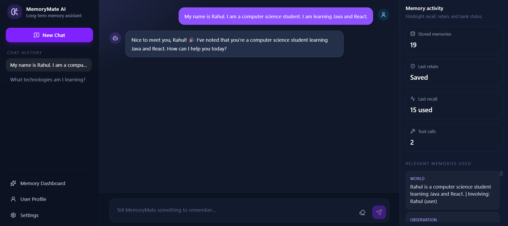
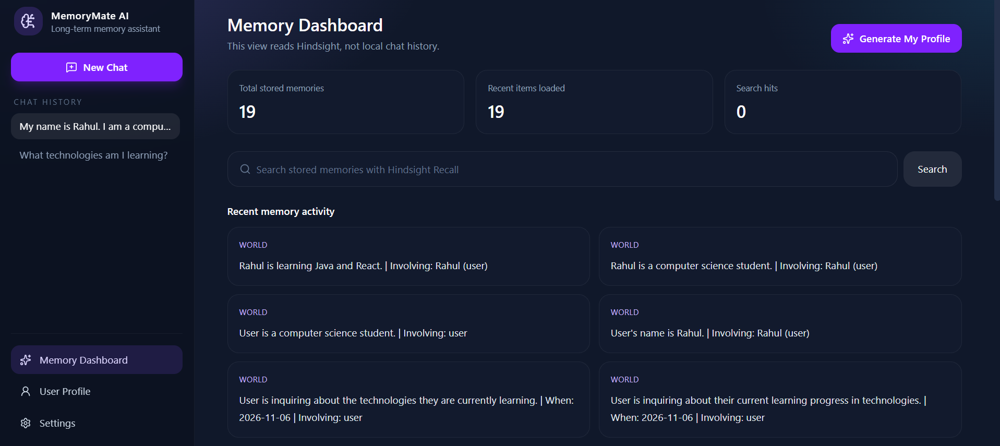
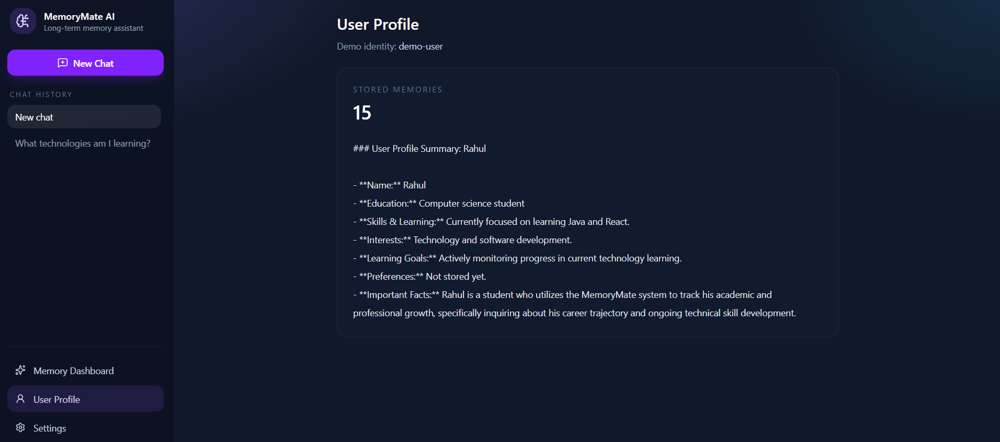

ok# MemoryMate AI

An intelligent personal AI assistant with long-term memory using [Hindsight](https://docs.hindsight.vectorize.io/cloud/typescript-sdk/) and [Groq](https://console.groq.com/docs/overview).

MemoryMate is a hackathon MVP: a working chat assistant, a memory dashboard, and real Retain / Recall / Reflect operations through the official `@vectorize-io/hindsight-client` SDK. Chat completions use Groq (`openai/gpt-oss-120b` by default).

## Problem

Most chatbots forget everything when a session ends. Personal assistants need durable memory: who the user is, what they are learning, what they prefer, and what they already explained.

## Solution

MemoryMate stores durable facts in a Hindsight memory bank, retrieves relevant memories before each Groq reply, and can reflect over stored memories to generate a profile. Browser chat history is short-term UI state. Hindsight is the source of long-term memory.

## Features

- Dark SaaS chat dashboard
- Groq chat with conversation history and local tool calling
- Hindsight **Retain** after useful user messages
- Hindsight **Recall** before every AI reply
- Hindsight **Reflect** for **Generate My Profile**
- Memory Dashboard with search and stored-memory counts
- Demo identity (`X-User-Id`) mapped to one Hindsight bank per id
- Honest errors when Groq or Hindsight is missing or fails

Demo identity is not production login. Different ids use different banks, but the header can be set by the client.

## Architecture

```
React (Vite)  --JSON /api-->  Express
                               |--> Groq Chat Completions (optional local tools)
                               |--> Hindsight Cloud SDK
                                    retain / recall / reflect / listMemories

localStorage   conversation titles and bubbles only
.env           GROQ_API_KEY and HINDSIGHT_API_KEY on the backend only
```

Chat flow:

1. Frontend `POST /api/chat` with the user message and recent bubbles.
2. Backend **Recall**s relevant Hindsight memories using that message.
3. Groq generates a reply, with memories in context. It may call `search_memories`, `save_memory`, or `list_recent_memories`.
4. Backend **Retain**s the user message unless it looks like a credential.
5. Response includes `reply`, recalled `memories`, and `toolCallCount`.

## Technology stack

| Layer | Tools |
| --- | --- |
| Frontend | React, Vite, Tailwind CSS, Lucide React, Axios |
| Backend | Node.js, Express |
| AI | Groq SDK (`GROQ_MODEL`, default `openai/gpt-oss-120b`) |
| Memory | `@vectorize-io/hindsight-client` |

## Hindsight integration

Official TypeScript SDK:

- `new HindsightClient({ baseUrl, apiKey })`
- `createBank(bankId, { name, reflectMission, retainMission, disposition })`
- `retain(bankId, content, options)`
- `recall(bankId, query, options)` → `response.results[].text`
- `reflect(bankId, query, options)` → `response.text`
- `listMemories(bankId, options)` for the dashboard

Cloud default: `https://api.hindsight.vectorize.io`

Local Hindsight: `HINDSIGHT_BASE_URL=http://localhost:8888`

## Installation

```bash
git clone <your-repo-url>
cd memorymate-ai
```

```bash
cd backend
npm install
```

```bash
cd frontend
npm install
```

## Environment variables

Copy `.env.example` to `.env` in the **project root** (the backend loads `memorymate-ai/.env`):

```bash
copy .env.example .env
```

Fill in real values. Never commit `.env`.

| Variable | Purpose |
| --- | --- |
| `PORT` | Backend port, default `5000` |
| `CORS_ORIGIN` | Frontend origin, default `http://localhost:5173` |
| `GROQ_API_KEY` | Groq key from https://console.groq.com |
| `GROQ_MODEL` | Groq model, default `openai/gpt-oss-120b` |
| `HINDSIGHT_API_KEY` | Hindsight Cloud API key |
| `HINDSIGHT_BASE_URL` | Hindsight API base URL |
| `DEMO_USER_ID` | Fallback if the client omits `X-User-Id` |

Without credentials the UI still runs. Settings shows service status. Chat and memory calls return clear errors instead of fake memory.

## How to run

Terminal 1:

```bash
cd backend
npm run dev
```

Terminal 2:

```bash
cd frontend
npm run dev
```

Open [http://localhost:5173](http://localhost:5173). Vite proxies `/api` to `http://localhost:5000`.

## Tests

External Groq and Hindsight calls are mocked.

```bash
cd backend
npm test
```

```bash
cd frontend
npm test
```

## Demo script for judges

1. Send: `My name is Rahul. I am a computer science student. I am learning Java and React.`
2. Refresh the browser and click **New Chat**.
3. Ask: `What technologies am I learning?`
4. Ask: `What are my career goals?` — it should only answer if that fact was stored.
5. Open **Memory Dashboard**, search for `Java`, then click **Generate My Profile**.

## API

- `POST /api/chat` — Recall, Groq generation (with `toolCallCount`), then Retain
- `GET /api/memories` — list stored memories
- `POST /api/memories/search` — Hindsight Recall
- `POST /api/memories/reflect` — Hindsight Reflect
- `GET /api/health` — backend, Groq, and Hindsight status

## Screenshots

Place images in `docs/screenshots/` (see that folder’s README), then they will render below:







## Demo video

Record a 60–90 second walkthrough of the five judge steps (chat → refresh → new chat → recall → dashboard Reflect).

Upload the file (unlisted YouTube, Drive, or the hackathon portal) and replace this line:

**Demo video:** https://youtu.be/BbCymxap0lg?si=tBPwYE-L1YRhAOZ3

Suggested outline:

1. Intro and New Chat
2. Rahul / Java / React retain
3. Refresh and New Chat
4. “What technologies am I learning?”
5. Memory Dashboard search + Generate My Profile

## Future improvements

- Real authentication (demo `X-User-Id` is not login)
- Streaming assistant tokens
- Voice input
- Mental models for always-fresh user profiles

## License

MIT
